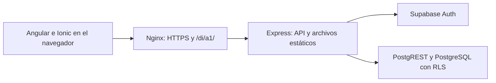

# Memoria técnica — Nexo

**Actividad individual 1 · Desarrollo de Interfaces (0488)**<br>
**Ciclo:** Desarrollo de Aplicaciones Multiplataforma (DAM)<br>
**Fecha:** 27 de octubre de 2026<br>
**Versión documentada:** código funcional del commit `326142a`<br>
**Aplicación:** https://sandbox.yerson.co/di/a1/<br>
**Autor:** Yerson Lasso.<br>
**Repositorio remoto:** pendiente de incorporar por el autor.

## 1. Objeto y alcance

Nexo es una aplicación de gestión de usuarios/clientes y proyectos, desarrollada con Ionic y Angular. Permite consultar información empresarial, crear registros, actualizar proyectos y generar informes. Está preparada como aplicación web progresiva (PWA) y publicada mediante HTTPS.

La solución utiliza datos sintéticos y diferencia dos perfiles: administrador y usuario estándar. El administrador consulta el conjunto de registros y gestiona las altas y los proyectos. El usuario estándar consulta su propio registro y los proyectos asociados, y modifica sus datos personales y preferencias desde Mi cuenta.

La versión documentada incorpora persistencia real en Supabase. Usuarios y clientes comparten una única tabla de aplicación con 15 columnas. La memoria describe el estado implementado; el apartado 12 identifica las diferencias respecto al enunciado original.

## 2. Tecnologías y versiones

Las versiones siguientes corresponden a las dependencias fijadas en el proyecto, no a una comprobación del catálogo de versiones disponible en Internet.

| Elemento | Versión o configuración | Función |
| --- | --- | --- |
| Angular | 22.2.2 | Componentes, rutas, formularios y cliente HTTP |
| Ionic Angular | 9.0.7 | Contenedor y controles de interfaz |
| TypeScript | 6.0.3 | Tipado de componentes y modelos |
| RxJS | 7.8.2 | Operaciones asíncronas y consulta periódica |
| Node.js | 26.11.1 en el servidor | Ejecución del backend y herramientas |
| npm | Rama 12 | Instalación reproducible con `package-lock.json` |
| Express | 5.3.0 | API y servicio de los archivos compilados |
| Supabase | Auth y PostgreSQL alojados | Autenticación, datos y autorización RLS |
| Terraform | Compatible con >= 1.10 y < 2 | Gestión declarativa del proyecto Supabase |
| Proveedor Terraform Supabase | 1.10.1 | Proyecto y configuración de Auth |
| Supabase CLI | 2.122.0 | Aplicación de migraciones SQL |
| jsPDF / AutoTable | 4.2.1 / 5.0.8 | Informes PDF tabulados |
| Compodoc | 2.0.0 | Documentación automática del frontend |
| Playwright | 1.64.1 | Pruebas de interfaz en navegador |
| PGlite | 0.5.12 | Ejecución local de pruebas PostgreSQL |

## 3. Arquitectura y organización

La aplicación separa presentación, acceso a datos y persistencia. En el frontend se sigue una organización compatible con MVVM: los modelos tipados representan los datos, las clases de página mantienen el estado y las plantillas describen la vista. Los servicios reúnen las operaciones compartidas.



El navegador se comunica con la API del mismo origen. Express valida las solicitudes y consulta Supabase mediante la clave publicable y el JWT del usuario autenticado. PostgreSQL aplica las políticas de filas y los privilegios por columna en cada operación ordinaria.

La clave secreta de Supabase se reserva para scripts administrativos de aprovisionamiento. No se utiliza para ejecutar las consultas normales de usuarios ni se incluye en la compilación Angular.

```text
src/app/
  app.component.ts         Contenedor, menú y navegación
  app.routes.ts            Rutas y carga diferida
  core/                    Modelos, servicios, guards e interceptor
  pages/                   Acceso, resumen, clientes, proyectos, cuenta y ayuda
  shared/                  Tabla reutilizable
server/                    API Express, adaptadores de Auth y PostgreSQL
supabase/migrations/       Historial SQL del esquema y sus políticas
infra/supabase/            Definición de infraestructura Terraform
scripts/                   Preparación, migraciones y verificaciones
tests/                    Pruebas de API, esquema, adaptadores e interfaz
deploy/                   Configuración de Nginx y systemd
```

El directorio activo es `actividad-1`. No se requiere un segundo directorio de trabajo para ejecutar ni mantener el proyecto.

## 4. Componentes, navegación y estado

### 4.1. Componentes de presentación

| Componente y ruta de código | Responsabilidad |
| --- | --- |
| `src/app/app.component.ts` | Estructura global, menú lateral, adaptación móvil, usuario y cierre de sesión |
| `src/app/pages/login.page.ts` | Acceso y validación de credenciales |
| `src/app/pages/dashboard.page.ts` | Actividad reciente e informe global para administración |
| `src/app/pages/clients.page.ts` | Tabla de 15 campos y alta de la entidad usuario/cliente |
| `src/app/pages/projects.page.ts` | Consulta, filtros, creación, modificación de estado/progreso y exportación |
| `src/app/pages/account.page.ts` | Edición del perfil propio y preferencias |
| `src/app/pages/help.page.ts` | Manual de uso integrado |
| `src/app/shared/data-table.component.ts` | Tabla compartida con búsqueda, ordenación y eventos |

Las páginas principales separan la lógica TypeScript de sus plantillas HTML. La tabla, la ayuda y el contenedor incorporan sus plantillas en el propio decorador `@Component`.

### 4.2. Rutas y control de acceso

Las rutas se definen en `src/app/app.routes.ts`. Las páginas se importan bajo demanda mediante `loadComponent`. `/login` permite el acceso; `/projects`, `/clients`, `/account` y `/help` requieren sesión. `/dashboard` exige además el rol administrador. `AppComponent` muestra la página seleccionada mediante `router-outlet`.

`authGuard` y `adminGuard` controlan la navegación. La API y PostgreSQL verifican los permisos de nuevo, de modo que ocultar una opción en pantalla no constituye la única protección.

### 4.3. Estado y comunicación

Se emplean `signal` para estados como carga, errores, sesión o registros, y `computed` para derivar filas y filtros. La estrategia `OnPush` permite reducir comprobaciones innecesarias de las vistas.

`DataTableComponent` recibe columnas, filas, título y etiqueta de acción mediante `input`. Emite `rowAction` y `searchChange` mediante `output`. Gestiona localmente el texto de búsqueda, la columna de ordenación y la dirección. Clientes y Proyectos reutilizan esta tabla con conjuntos de datos distintos.

`AuthService` mantiene la sesión y las preferencias; `DataService` agrupa las operaciones HTTP; `ExportService` genera los documentos. Angular proporciona estas dependencias mediante `inject`.

## 5. Formularios y operaciones asíncronas

Los formularios de acceso, alta de clientes, proyectos y cuenta utilizan formularios reactivos con `FormBuilder`, controles tipados y validadores. Se comprueban campos obligatorios, longitudes, correo, presupuesto y preferencias admitidas. El backend vuelve a validar los datos antes de guardarlos.

La disponibilidad del correo se comprueba al abandonar el campo. El validador utiliza un temporizador de 300 ms y `switchMap` para consultar la API. La interfaz diferencia comprobación pendiente, correo duplicado y fallo de conexión. Mientras la comprobación está pendiente no se permite guardar.

`DataService.workspace()` reúne clientes y proyectos con `forkJoin`. Las operaciones puntuales se consumen mediante `firstValueFrom` y `async/await`. La actividad se consulta con `timer(0, 5000)` y `switchMap`: es una actualización periódica cada cinco segundos. `takeUntilDestroyed` cancela las suscripciones asociadas a componentes cuando estos se destruyen.

Las altas y modificaciones actualizan el estado visible tras la respuesta del servidor. Los errores se presentan mediante mensajes y opciones de reintento; los indicadores de carga y bloqueo impiden envíos simultáneos desde un mismo formulario.

## 6. Modelo de datos

### 6.1. Entidad unificada: usuarios y clientes

`public.nexo_users` contiene exactamente 15 columnas. La tabla de Clientes muestra las 15, con desplazamiento horizontal. El alias `name` empleado por algunos contratos e informes deriva del nombre almacenado y no añade una columna física.

| Nº | Columna | Tipo | Uso y control |
| --- | --- | --- | --- |
| 1 | `id` | text, clave primaria | Identidad y relación con proyectos; solo lectura en la interfaz |
| 2 | `email` | text, único | Correo del registro; se introduce en el alta y no se modifica desde el perfil |
| 3 | `full_name` | text | Nombre completo; entre 2 y 120 caracteres útiles |
| 4 | `display_name` | text | Nombre visible; entre 2 y 60 caracteres útiles |
| 5 | `role` | text | `admin` o `user`; valor inicial de un cliente: `user` |
| 6 | `phone` | text | Teléfono opcional; máximo 30 caracteres |
| 7 | `job_title` | text | Puesto opcional; máximo 80 caracteres |
| 8 | `sector` | text | Sector; máximo 60 caracteres; obligatorio en el alta de cliente |
| 9 | `locale` | text | `es-ES` o `en-GB`; formato de importes y fechas del perfil |
| 10 | `timezone` | text | Madrid, UTC o Bogotá; presentación de fechas con hora |
| 11 | `theme` | text | Tema claro, oscuro o del sistema |
| 12 | `notifications_enabled` | boolean | Preferencia de anuncios de actividad para lectores de pantalla |
| 13 | `created_at` | timestamptz | Fecha de creación generada por PostgreSQL |
| 14 | `updated_at` | timestamptz | Fecha de actualización gestionada por trigger |
| 15 | `last_login_at` | timestamptz, admite null | Último acceso registrado mediante una función de base de datos |

La preferencia de avisos controla el anuncio accesible de actividad; no representa notificaciones push ni envío de correos. Los formatos del perfil se aplican a las fechas de cuenta/actividad y a los importes de la tabla de proyectos. Las exportaciones conservan su formato específico.

`auth.users` pertenece al sistema interno de Supabase Auth y conserva la identidad de autenticación. Crear un cliente en la interfaz no crea automáticamente una cuenta de acceso. Al aprovisionar una identidad Auth cuyo correo ya existe, un trigger enlaza el registro existente y actualiza en cascada las referencias de sus proyectos. Los identificadores históricos de clientes se mantienen como texto hasta que corresponde vincularlos a una identidad Auth.

### 6.2. Proyectos y actividad

`nexo_projects` contiene identificador, nombre, referencia al usuario/cliente, presupuesto, estado, fecha de entrega, progreso y fecha de creación. `client_id` referencia a `nexo_users.id`, con actualización en cascada y borrado restringido.

El presupuesto se limita al intervalo de 0 a 10.000.000. El progreso es un entero entre 0 y 100. Los estados admitidos son Pendiente, En curso y Completado. Una restricción de base de datos exige progreso 0 para Pendiente y 100 para Completado.

`nexo_activity` almacena identificador, documento `payload` de tipo JSONB y fecha de creación. Los triggers generan los eventos de alta de clientes, creación de proyectos y actualización de proyectos dentro de la misma transacción. Esta actividad documental reside en PostgreSQL; no existe una segunda base NoSQL independiente.

## 7. Autenticación y seguridad

Supabase Auth verifica las credenciales y emite el token de acceso. Express lo conserva en una cookie `HttpOnly`, `SameSite=Strict` y `Secure` en producción, limitada a `/di/a1/` en el despliegue. La sesión de la aplicación dura como máximo una hora y no incorpora renovación automática del token. Los tokens no se almacenan en `localStorage`.

La API utiliza Helmet, limita el tamaño de los cuerpos JSON y restringe los intentos de inicio de sesión a 30 por cada ventana de 15 minutos. Las mutaciones requieren la cabecera propia `X-Nexo-Request` y rechazan las llamadas que declaran un contexto de origen no permitido. Los mensajes al cliente no revelan detalles internos de PostgreSQL.

### 7.1. Autorización RLS y privilegios por columna

| Operación | Administrador | Usuario estándar | Anónimo |
| --- | --- | --- | --- |
| Consultar usuarios/clientes | Todos | Solo su registro | Denegado |
| Actualizar perfil | Solo su propio perfil | Solo su propio perfil | Denegado |
| Crear cliente | Permitido con rol inicial `user` | Denegado | Denegado |
| Consultar proyectos | Todos | Solo los asociados a su ID | Denegado |
| Crear proyectos y modificar estado/progreso | Permitido | Denegado | Denegado |
| Consultar actividad global | Permitido | Sin filas visibles | Denegado |
| Insertar actividad directamente | Denegado; la generan triggers | Denegado | Denegado |
| Borrar registros desde la API | No implementado | No implementado | Denegado |

Las políticas comparan `auth.uid()` con el identificador del registro y consultan el rol persistido mediante `nexo_private.is_admin()`. No se confía en un rol enviado por el navegador ni en metadatos editables del usuario. La función auxiliar utiliza `SECURITY DEFINER` con `search_path` vacío para evitar recursión de políticas y resolver explícitamente los objetos.

Los privilegios de actualización de perfiles se conceden únicamente a las nueve columnas editables: nombre completo, nombre visible, teléfono, puesto, sector y las cuatro preferencias. `id`, `email`, `role` y las fechas no son modificables mediante el cliente HTTP ordinario. El alta permite introducir correo e identificador, pero no asignar roles administrativos ni fechas de auditoría. La actualización de proyectos está limitada a `status` y `progress`.

El registro público de cuentas está desactivado mediante Terraform. La asignación inicial del administrador se realiza en el script privado de aprovisionamiento.

### 7.2. Configuración privada

El archivo `.env.example` enumera los nombres de las variables. Los valores reales se guardan en `.env`, excluido de Git.

| Variables | Finalidad |
| --- | --- |
| `SUPABASE_URL`, `SUPABASE_PUBLISHABLE_KEY` | Conexión del backend con Auth y PostgREST |
| `SUPABASE_SECRET_KEY` | Aprovisionamiento administrativo de cuentas |
| `SUPABASE_ACCESS_TOKEN`, `SUPABASE_ORGANIZATION_ID` | Gestión del proyecto mediante Terraform/CLI |
| `SUPABASE_PROJECT_REF`, `SUPABASE_DB_PASSWORD` | Identificación del proyecto y migraciones |
| `ADMIN_PASSWORD`, `USER_PASSWORD` | Contraseñas iniciales de las cuentas de demostración |

El estado de Terraform, sus planes y los archivos privados de variables también están excluidos del repositorio.

## 8. Contratos principales de la API

| Método y ruta relativa | Función |
| --- | --- |
| `POST /api/auth/login` | Autenticar, registrar acceso y establecer cookie |
| `GET /api/auth/me` | Recuperar el perfil de sesión |
| `POST /api/auth/logout` | Solicitar cierre de sesión en Auth y eliminar cookie |
| `PATCH /api/profile` | Modificar los campos permitidos del perfil propio |
| `GET /api/sql/clients` | Obtener los campos del registro unificado sujetos a RLS |
| `GET /api/sql/email-available` | Comprobar disponibilidad de correo |
| `POST /api/sql/clients` | Crear un cliente y sus preferencias |
| `GET /api/sql/projects` | Consultar los proyectos autorizados |
| `POST /api/sql/projects` | Crear un proyecto como administrador |
| `PATCH /api/sql/projects/:id` | Actualizar estado y progreso como administrador |
| `GET /api/nosql/activity` | Consultar la actividad documental JSONB |
| `GET /api/admin/summary` | Obtener agregados de clientes, proyectos y presupuesto |

En producción se antepone `/di/a1` a estas rutas. La denominación `nosql` mantiene el contrato de la interfaz y no implica una base NoSQL independiente. El adaptador pagina los listados en bloques de 500 registros y limita cada consulta a Supabase a diez segundos.

## 9. Interfaz, accesibilidad e informes

La interfaz utiliza CSS Grid y Flexbox, menú lateral adaptable y tablas con desplazamiento horizontal. Los estados de carga se muestran con indicadores Ionic. Los formularios incluyen etiquetas asociadas, mensajes de validación y atributos como `aria-invalid`.

Se incluyen enlace para saltar al contenido, foco visible, encabezados semánticos, avisos mediante regiones de estado y botones de ordenación con `aria-sort`. El cambio de página dirige el foco al encabezado principal. La tabla admite acceso por teclado a su contenedor desplazable.

El usuario puede seleccionar tema claro, oscuro o del sistema y configurar su formato regional y zona horaria. La preferencia de anuncios controla `aria-live` en la actividad del resumen.

Los informes CSV y PDF de Proyectos respetan la búsqueda y el filtro de estado. El PDF del resumen incluye todos los proyectos visibles para administración. Las bibliotecas PDF se cargan bajo demanda. El CSV utiliza UTF-8 con BOM, separador de punto y coma, escape de comillas y neutralización de valores que podrían interpretarse como fórmulas. El PDF incluye tabla, cabeceras y numeración de páginas.

La configuración PWA conserva recursos de interfaz mediante el service worker de Angular. No define caché de respuestas API. La autenticación y las operaciones con datos requieren conexión; no existe sincronización de cambios realizados sin conexión.

## 10. Instalación, infraestructura y despliegue

### 10.1. Preparación local

Se requiere Node.js de la rama 26, npm de la rama 12 y acceso al proyecto Supabase. Desde la raíz del proyecto:

```bash
npm ci
npm run setup
# Completar .env siguiendo .env.example
npm run db:plan
npm run db:setup
npm run db:users
npm start
```

`npm run setup` genera contraseñas iniciales si `.env` no existe. `db:users` crea las cuentas de demostración; si ya existen no rota sus contraseñas. Angular se sirve en el puerto 4200 y utiliza un proxy para la API local del puerto 4310.

### 10.2. Infraestructura y migraciones reproducibles

Terraform gestiona el proyecto Supabase y la desactivación del registro público. Puede importar un proyecto existente mediante `SUPABASE_PROJECT_REF`. El proyecto desplegado se incorporó al estado de Terraform por importación. `prevent_destroy` evita su destrucción accidental desde esa configuración e `ignore_changes` evita rotar automáticamente su contraseña al importar.

```bash
npm run infra -- init
npm run infra -- plan
npm run infra -- apply
npm run db:plan
npm run db:setup
npm run db:verify
```

Los parámetros de nombre y región se definen en el archivo privado de variables a partir del ejemplo de `infra/supabase`. Debe mantenerse un único estado activo por proyecto.

Los comandos de tablas están guardados en `scripts/database.mjs`. Este script ejecuta Supabase CLI con una versión fijada y aplica las migraciones pendientes. Terraform no aplica directamente el esquema SQL.

| Migración | Contenido |
| --- | --- |
| `20261027000100_nexo.sql` | Tablas de negocio iniciales, restricciones y actividad transaccional |
| `20261027000200_users_rls.sql` | Perfil de 15 columnas, integración Auth y permisos |
| `20261027000300_unify_users_clients.sql` | Unificación usuario/cliente, conservación de relaciones y políticas finales de lectura |
| `20261027000400_client_fields.sql` | Permisos de alta para los campos y preferencias del formulario actualizado |

Las migraciones se aplican en orden y conservan el historial de evolución. `supabase/seed.sql` contiene datos sintéticos opcionales para una instalación vacía y no se ejecuta en cada arranque.

### 10.3. Despliegue real

La URL de producción es https://sandbox.yerson.co/di/a1/. Nginx termina HTTPS y dirige `/di/a1/` a `127.0.0.1:4311`, retirando ese prefijo al reenviar la solicitud. `/di/a1` redirige a la ruta con barra final.

La configuración Angular de sandbox fija `baseHref` a `/di/a1/`. El interceptor construye las URL de API a partir de la base del documento. El servicio systemd `nexo-a1` ejecuta Express, carga `.env` y sirve `dist/nexo-sandbox/browser`.

```bash
npm run build:sandbox
sudo systemctl restart nexo-a1
sudo systemctl status nexo-a1
```

El repositorio conserva la configuración en `deploy/nginx.conf`, `deploy/nexo-a1.service` y `angular.json`.

## 11. Pruebas y control de versiones

### 11.1. Validación de la versión documentada

El 27 de octubre de 2026 se completaron las siguientes comprobaciones durante el desarrollo de esta versión:

| Verificación | Resultado y alcance |
| --- | --- |
| `npm test` | 17 pruebas aprobadas: API, adaptadores y PostgreSQL |
| `npm run test:e2e` | 4 pruebas aprobadas: administración, usuario estándar, móvil y cuenta |
| Compilación local y sandbox | Ambas completadas |
| `npm run docs` | Documentación Compodoc generada |
| `npm run db:verify` | RLS y persistencia verificadas mediante JWT reales de ambas cuentas |
| Navegador sobre producción | Acceso, tabla de 15 campos, controles de alta, aislamiento de datos, perfil, recarga y salida comprobados |
| Terraform | Última comprobación sin diferencias entre el estado y la configuración del proyecto |

Las pruebas PostgreSQL se ejecutan con PGlite y comprueban restricciones, 15 columnas, migración, enlaces de proyectos y accesos de roles. Las pruebas E2E utilizan un backend de pruebas aislado y no crean registros en Supabase. La verificación directa de Supabase modifica temporalmente el teléfono del usuario y lo restaura.

En la comprobación de datos del 27 de octubre se conservaron seis registros unificados —cuatro clientes sintéticos previos y dos cuentas de demostración— y seis proyectos. Este recuento es una evidencia de ese momento, no una restricción del sistema.

La auditoría Lighthouse disponible corresponde al **14 de octubre de 2026**, anterior a los cambios de Supabase y a la tabla ampliada. Se conserva como evidencia histórica:

| Ruta auditada | Performance | Accessibility | Best Practices |
| --- | --- | --- | --- |
| Login | 70 | 100 | 100 |
| Resumen | 81 | 100 | 100 |

Los informes están en `artifacts/lighthouse/`. Esos resultados no certifican la interfaz actual ni el cumplimiento integral de WCAG. Para la entrega debe ejecutarse y adjuntarse una auditoría de la versión final publicada.

### 11.2. Git, documentación y CI/CD

El repositorio utiliza `main`, `develop` y ramas `feature/*`. Los cambios funcionales recientes incluyen `28e46da` (Supabase y unificación), `c7a2623` (campos de clientes) y su integración en `326142a`. Los commits emplean la identidad Git configurada por el autor y descripciones breves.

El workflow `.github/workflows/ci.yml` define instalación, pruebas, compilación, Compodoc y E2E. Conserva la documentación y los informes de pruebas como artefactos. El despliegue opcional a Vercel depende del éxito del trabajo de comprobación y de variables y secretos de configuración.

Actualmente no hay un remoto Git configurado. Por tanto, el workflow existe como configuración, pero no se acredita una ejecución remota de GitHub Actions ni un despliegue automático de este servidor mediante ese pipeline. El despliegue comprobado utiliza Nginx y systemd.

## 12. Correspondencia con el enunciado y límites

| Requisito del enunciado | Estado de la versión documentada |
| --- | --- |
| Navegación global, carga diferida y dos roles | Implementado con rutas, guards y comprobaciones en servidor y RLS |
| Formularios declarativos, binding y validación asíncrona | Implementado |
| Dos componentes visuales reutilizables e independientes | Parcial: existe una tabla compartida; los widgets adicionales se retiraron al simplificar la interfaz |
| Comunicación por propiedades y eventos | Implementada en `DataTableComponent` |
| Consumo asíncrono relacional y documental | REST relacional y documentos JSONB con consulta periódica; no hay un servicio NoSQL independiente ni tiempo real por suscripción |
| Dashboard con gráficos | No cubierto en la versión simplificada: se mantiene actividad e informes y se retiraron los gráficos por petición del usuario |
| Informes PDF y CSV | Implementados |
| Adaptación y accesibilidad | Medidas implementadas y pruebas de interfaz; auditoría final de la versión actual pendiente |
| Documentación automática y manual | Compodoc, README, Ayuda y esta memoria |
| Git y flujo de ramas | Implementados en el repositorio local; publicación remota pendiente |
| CI/CD y producción | Configuración de CI/CD disponible y producción funcional; automatización remota no acreditada |

El acceso está limitado a las funciones implementadas: no hay edición administrativa de perfiles ajenos, borrado desde la API, recuperación de contraseña integrada, invitaciones desde el formulario ni notificaciones push. La sesión requiere un nuevo acceso al caducar. Estas funciones quedan fuera del alcance actual.

Para completar el documento final de entrega del enunciado deben añadirse la URL del repositorio accesible, el enlace a la documentación generada, las credenciales de demostración por un canal privado y la auditoría Lighthouse final. Esta memoria no incluye contraseñas, tokens ni valores privados de infraestructura.

## 13. Archivos de referencia y comandos de comprobación

La fuente principal de esta memoria es el código del proyecto y el documento «Actividad individual 1 — Individual — DI 0488». Las rutas se expresan relativas a la raíz del repositorio para que sean válidas al trasladarlo.

| Archivo o carpeta | Información verificable |
| --- | --- |
| `package.json` y `package-lock.json` | Versiones y scripts |
| `src/main.ts`, `src/app/app.routes.ts` | Arranque, proveedores y rutas |
| `src/app/core/` | Modelos, sesión, datos, exportaciones y autorización de navegación |
| `src/app/pages/`, `src/app/shared/` | Vistas y tabla reutilizable |
| `server/app.mjs`, `server/supabase-*.mjs` | API y adaptadores de Supabase |
| `supabase/migrations/` | Tablas, triggers, permisos y RLS |
| `scripts/database.mjs`, `scripts/verify-database.mjs` | Aplicación de migraciones y verificación real |
| `infra/supabase/` | Infraestructura declarativa |
| `tests/`, `playwright.config.ts` | Pruebas y configuración de navegador |
| `deploy/`, `.github/workflows/ci.yml` | Despliegue y pipeline |
| `README.md`, `documentation/index.html` | Manual y documentación generada |

```bash
npm test
npm run build
npm run test:e2e
npm run docs
npm run db:verify
```

Las pruebas de navegador requieren Chromium instalado; puede indicarse una instalación compatible mediante `CHROMIUM_PATH`. Las comprobaciones sobre Supabase requieren las variables privadas correspondientes en `.env`.
